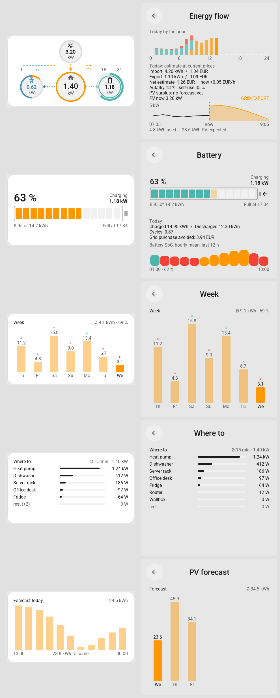

# Power Origin

> **Beta, early stage.** Tested on one 4-inch screen only. Expect rough edges, and options that may still change.

Where your home's power comes from, at a glance: solar, grid, house and battery as four rings, after the
[Power Origin card](https://github.com/hoizi89/power-origin-card) for Home Assistant, redrawn natively for Tessera
screens. Five tiles share one plugin:

| Tile | Shows | Tap opens |
|---|---|---|
| **Energy flow** (2x2 and up) | Solar, grid, house and battery as rings; the house ring split by source; today's hours as dots or bars | Today hour by hour (stacked solar / battery / grid, tap an hour for its split), cost so far and per hour, autarky and self-use, the best solar window from Solcast |
| **Battery** | State of charge in the original's battery shell, one cell per kWh, power, "lasts until" / "full at" | Today's charge and discharge, cycles, grid purchase avoided, the last 12 hours |
| **Week** | Seven days of solar with each day's autarky | The same, full size |
| **Where to** | Up to eleven devices you choose, largest first, the rest of the house last | Every device that fits |
| **PV forecast** | Today's Solcast forecast by the hour, what is still to come | The coming days |

A tap on the middle of the energy rings switches to one large ring, as the original's centre: what is free by day,
the house, the cost per hour, then back to the four rings. Holding a tile does the same as tapping it.

## Set up

Add the plugin, place a tile and choose its sensors in the tile's options. Nothing is guessed: a sensor that is not
chosen, unavailable or in a unit the tile cannot read shows `--` or leaves its part out, never a zero.

- **Power** sensors in W or kW. By default a positive grid means import and a positive battery means charging; if
  yours are the other way round, choose **Invert** grid, battery or both.
- **State of charge** in `%`.
- **Today's energy** (import, export, house, solar, battery charge and discharge) in Wh or kWh, sensors that start
  from zero each day.
- **Prices** in EUR/kWh (sensor or `input_number`). Costs multiply today's energy by the **current** price: an
  estimate, not a bill.
- **Battery reserve**: a sensor or `input_number` with your minimum SoC; cells turn red within 5 % of it.
- **Week** and the battery's **last 12 hours** need sensors with long-term statistics (a `state_class`).
- **PV forecast** needs the [Solcast integration](https://github.com/BJReplay/ha-solcast-solar).

## What it asks Home Assistant

- `recorder/statistics_during_period` for the hourly and daily history.
- `solcast_solar.query_forecast_data` for the forecast.

Both only read; nothing in Home Assistant is changed.

## Screens

Tested on one screen only, a Guition ESP32-S3-4848S040 (480 x 480); other screens are untested beyond the simulator.
Reports from other screens are welcome as issues. Texts in English and German, following the screen's language.

## Credits

The look, the source split of the house ring and the battery formulas follow Power Origin by Robert Holzinger
(MIT, see `LICENSE.power-origin`). This is an independent port, not made or endorsed by its author.
